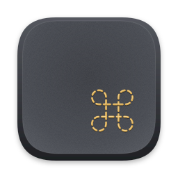
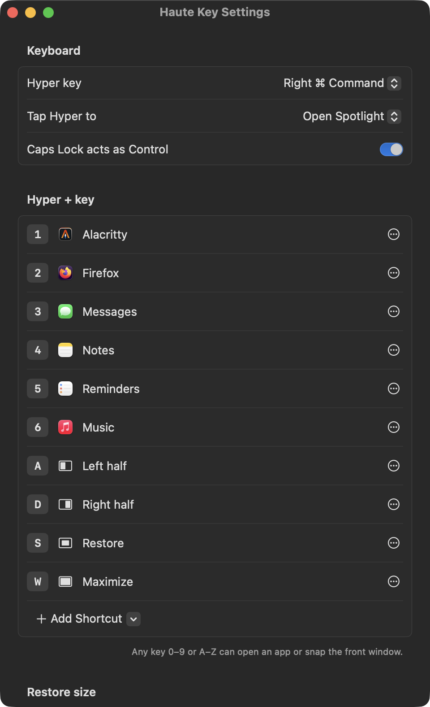

<p align="center">
  
</p>

<h1 align="center">Haute Key</h1>

<p align="center">
  <strong>A Hyper key for your Mac.</strong><br>
  Tap right ⌘ for Spotlight. Hold it to jump to apps and snap windows.
</p>

<p align="center">
  
  
  <a href="https://github.com/sponsors/joshtronic"></a>
</p>

---

Haute Key turns one key, right ⌘ by default, into a GNOME-style Super key. It's one small
menu bar app: no Karabiner, no kernel extensions, no subscription.

| Press | Does |
|---|---|
| **Hyper** (tap) | Opens Spotlight |
| **Hyper + 1–9, 0** | Opens or switches to an app. On first launch, these follow the apps pinned in your Dock. |
| **Hyper + W** | Maximizes the front window |
| **Hyper + A** / **D** | Snaps it to the left or right half |
| **Hyper + S** | Restores its size from before you snapped it |
| **Caps Lock** | Acts as Control, if you turn it on |

Every key from 0–9 and A–Z can open an app or snap a window. The tap can open Spotlight, any
app (Raycast and Alfred work too), or press a shortcut of your choice. The Hyper key can be
right ⌘, right ⌥, right ⌃, or Caps Lock.

<p align="center">
  
</p>

## Why this exists

I bounce between GNOME and macOS, and GNOME gets one thing exactly right: the Super key.
Tap it and you're searching, so you type an app name and hit Enter. Hold it and press
a number to jump to an app in the dock, or press a direction to snap the window. Back in
2012 I described Activities as "one key, one place, do it all." I map Super to the
*right-hand* Super key, because otherwise
["I'd probably never touch that key"](https://joshtronic.com/2018/09/09/why-i-dont-use-a-tiling-window-manager/).

I've been trying to get that same muscle memory on a Mac for over a decade:

- **2014:** Alfred for launching, and Spectacle to
  ["place windows with hot keys not unlike how xmonad works"](https://joshtronic.com/2014/07/20/tools-of-the-trade-2014/).
- **2016:** Hammerspoon to bind modifier+number to my most-used apps, inspired by picking
  weapons in Doom and Quake
  ([Fastest way to switch between apps](https://joshtronic.com/2016/04/03/fastest-way-to-switch-between-apps/)).
  Then Karabiner, so tapping **right ⌘** opened the launcher and right ⌘+number opened apps
  ([Leveraging the power of the right command key in OS X](https://joshtronic.com/2016/06/05/leveraging-the-power-of-the-right-command-key-in-os-x/)).
- **Later in 2016:** a macOS update broke Karabiner, and
  ["this reliance on third-party hackery"](https://joshtronic.com/2016/10/16/switching-from-mac-os-x-back-to-linux-part-1/)
  sent me back to Linux, where window snapping and app hotkeys are built in.
- **2024:** back on a Mac, I tried Hyperkey with Hammerspoon, then Caps Lock as Hyper, and
  landed on Karabiner-Elements plus Raycast. Right ⌘ tapped opens the launcher, right ⌘+1–9
  opens apps, and right ⌘+WASD snaps windows, just like GNOME's Super+WASD
  ([My quest to align hotkeys on macOS and GNOME](https://joshtronic.com/2024/11/10/align-hotkeys-macos-gnome/)).

That last setup worked, but it took two apps, and Raycast was doing very little. I don't need
a launcher with extensions. Spotlight is closer to how GNOME's search works anyway. Then Raycast
put window snapping behind a subscription, so I was paying yearly for a few hotkeys.

Haute Key is that whole setup in one app.

## Install

Signed downloads are coming. For now, build it from source.

**You need** macOS 15 or later, and Xcode installed and selected
(`sudo xcode-select -s /Applications/Xcode.app`).

```sh
git clone https://github.com/joshtronic/hautekey.git
cd hautekey
scripts/create-dev-cert.sh     # once: a local signing certificate, so permissions survive rebuilds
scripts/build-app.sh --open    # builds, signs, installs ~/Applications/Haute Key.app, and launches it
```

The first time it runs, Haute Key walks you through two permissions in **System Settings →
Privacy & Security**:

- **Input Monitoring**, so it can see the Hyper key.
- **Accessibility**, so it can move windows.

If Haute Key isn't in a list, click **+** and choose it from `~/Applications`. It starts
working as soon as both are on, with no restart, and it launches at login from then on.

## Configuration

Use **Settings…** in the menu bar, or open the app again to bring Settings back if you've
hidden the icon.

Your shortcuts are saved to `~/.config/hautekey/config.json` and apply as soon as the file
changes, whether you edit it in Settings, in the built-in editor, or in your own editor. The
file can be a symlink, so it's easy to keep in your dotfiles and share between Macs. Settings
that only make sense on one Mac, like launch at login and the menu bar icon, aren't stored in it.

```json
{
  "bindings" : {
    "1" : { "app" : "org.alacritty" },
    "2" : { "app" : "org.mozilla.firefox" },
    "3" : { "app" : "com.apple.MobileSMS" },
    "4" : { "app" : "com.apple.Notes" },
    "5" : { "app" : "com.apple.reminders" },
    "6" : { "app" : "com.apple.Music" },
    "a" : { "snap" : "leftHalf" },
    "d" : { "snap" : "rightHalf" },
    "s" : { "snap" : "restore" },
    "w" : { "snap" : "maximize" }
  },
  "capsLockToControl" : true,
  "hyperKey" : "rightCommand",
  "restoreSize" : { "height" : 0.6, "width" : 0.6 },
  "tapAction" : { "type" : "spotlight" },
  "version" : 1
}
```

## Good to know

- **Karabiner-Elements:** quit it before using Haute Key, or it grabs the keyboard first.
  Haute Key warns you in its menu if Karabiner is running.
- **Secure input:** while a password field or Terminal's Secure Keyboard Entry is active, macOS
  hides key presses from every app, so the Hyper key does nothing until it's off.
- **Your own `hidutil` remaps:** Haute Key sets the system's key mapping itself, which replaces
  any mapping you made with `hidutil`. Quitting Haute Key clears it.
- **Window snapping** goes to exact halves of the screen, with no gaps, and never moves a
  window to another display.

## Development

```sh
swift test                  # core logic: config, tap/hold, snap math
scripts/build-app.sh        # build, sign, and install without launching
scripts/make-icon.sh        # regenerate Resources/AppIcon.icns from AppIcon.svg (needs librsvg)
```

## Uninstall

Quit Haute Key (that clears its key mapping) and delete `~/Applications/Haute Key.app`. To
remove your settings as well, delete `~/.config/hautekey`.

## Support

Haute Key is free and always will be. If it saves you a subscription, you can
[sponsor me on GitHub](https://github.com/sponsors/joshtronic). Totally optional, and much
appreciated.

## License

GPL-3.0. See [LICENSE](LICENSE).
